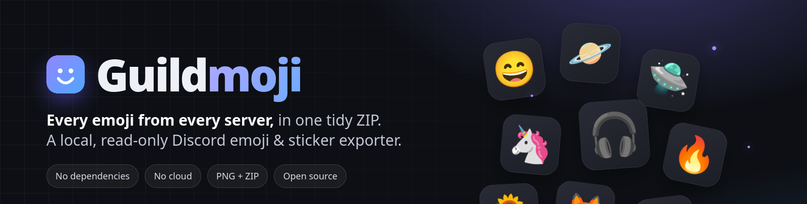
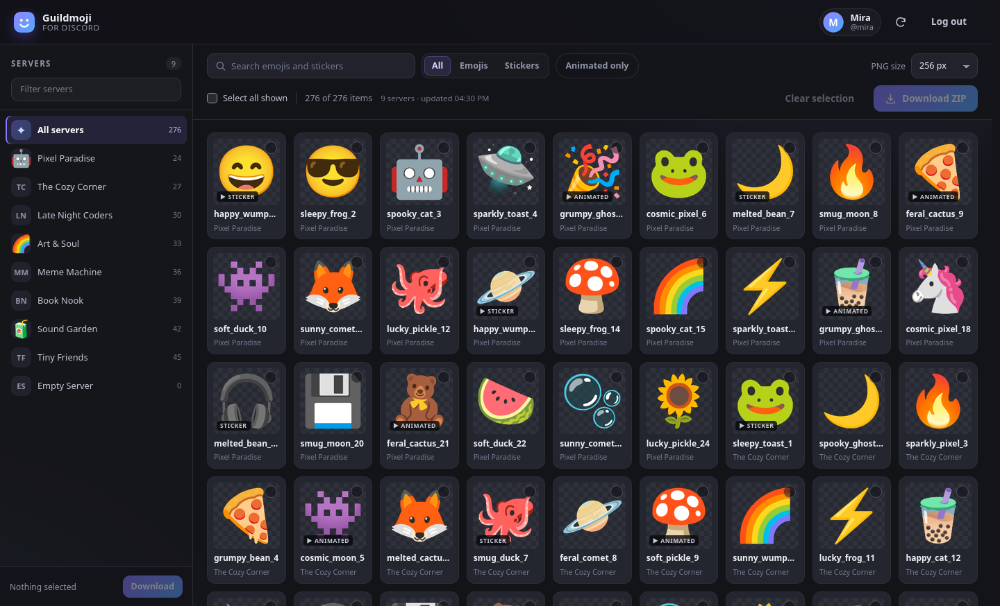
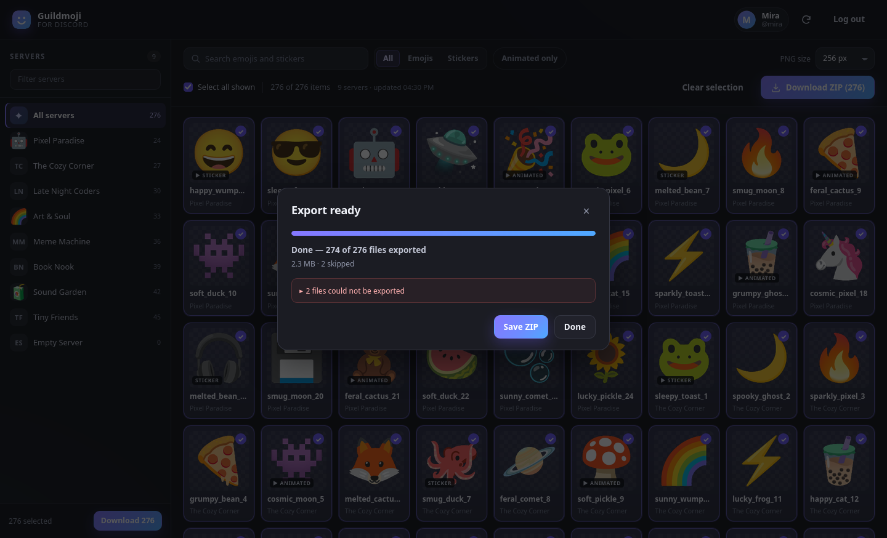
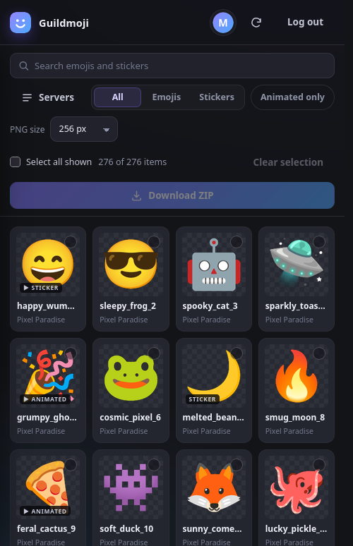

<p align="center">
  
</p>

<h1 align="center">Guildmoji</h1>

<p align="center">
  <strong>Every custom emoji and sticker from your Discord servers, in one searchable grid.</strong><br>
  Pick the ones you like and export them as a tidy ZIP of PNG files.
</p>

<p align="center">
  <a href="https://github.com/Flo-cg/guildmoji/actions/workflows/ci.yml"></a>
  
  
  <a href="LICENSE"></a>
</p>

<p align="center">
  
</p>

<p align="center">
  <sub>Demo data and fictional servers. The real grid shows the emoji and stickers from your own servers.</sub>
</p>

Guildmoji is a small self-hosted web app for collecting the custom emoji and
stickers that already live in your Discord servers. It gathers them into one
browsable grid, lets you filter and hand-pick favourites, and builds a ZIP with
one folder per server, a `stickers/` subfolder, and a `manifest.json` that maps
every file back to its emoji ID and original CDN URL.

It is deliberately boring in the best way: **one Node.js process, no npm
dependencies, no build step, no cloud service, and no telemetry.** The web
interface is plain HTML, CSS, and JavaScript.

## Features

- **One grid for everything** — custom emoji and stickers from every server you
  are in, with a per-server sidebar.
- **Fast filtering** — search names and servers, sort by type, or show animated
  assets only.
- **Pick exactly what you want** — click cards, select all visible results, and
  keep your selection across page reloads.
- **Clean PNG exports** — choose 128, 256, or 512 px. Animated emoji and APNG
  stickers become a still PNG of their first frame.
- **Background exports** — progress, cancellation, partial-failure reporting,
  and a download when the archive is ready.
- **A useful archive** — server folders, `stickers/` subfolders, safe file
  names, and a detailed `manifest.json`.
- **Saved-login support** — reads the token already stored by the Discord
  desktop client on Linux, including tokens in Snappy-compressed LevelDB blocks.
- **Local by default** — binds to `127.0.0.1`, keeps the token in memory only,
  and only talks to Discord.
- **No dependencies** — Node.js 20+ is the only requirement. `ffmpeg` is
  optional for rare GIF/WebP stickers.

## Quick start

```bash
git clone https://github.com/Flo-cg/guildmoji.git
cd guildmoji
npm start
```

Open <http://127.0.0.1:4173> and click **Use the saved Discord login** if you use
the Discord desktop app on Linux, or paste a token manually.

There is **no `npm install` step** because there are no dependencies. If port
4173 is busy, the server tries the next free port and prints the actual URL.

### Requirements

| Requirement | Notes |
| --- | --- |
| Node.js 20+ | Check with `node --version` |
| Linux | Automatic saved-login discovery is Linux-only. The app itself can run on macOS and Windows with a manually pasted token. |
| Discord desktop or web | Desktop app for automatic login; any browser for manual login. |
| `ffmpeg` (optional) | Only needed for rare GIF/WebP assets. APNG stickers and animated emoji do not need it. |

On Arch Linux, for example:

```bash
sudo pacman -S nodejs ffmpeg   # ffmpeg is optional
```

## Connect your Discord account

### Option 1: Use the saved desktop login (Linux)

Click **Use the saved Discord login**. Guildmoji looks for a session in the
local data of the clients it knows about:

- `~/.config/discord`, `~/.config/discordcanary`, `~/.config/discordptb`, and
  related profiles
- Vesktop, Vencord, Equicord, Legcord, ArmCord, and Dorion profiles
- Flatpak (`~/.var/app/...`) and Snap installations

Discord's Chromium storage keeps the session in a LevelDB database. Those
databases use Snappy-compressed blocks and prefix-compressed keys, so a simple
text search often misses the real token. Guildmoji includes a small,
dependency-free LevelDB table/WAL reader specifically for this job.

If the token is protected by a system keyring, automatic discovery cannot read
it. Use the manual method below instead. Nothing is sent anywhere during
discovery; the token is kept in the server process memory only.

### Option 2: Paste a token manually

The most reliable method is to copy the `Authorization` header from a Discord
API request:

1. Open Discord (desktop app or <https://discord.com/app>).
2. Press <kbd>Ctrl</kbd>+<kbd>Shift</kbd>+<kbd>I</kbd> to open developer tools.
3. Open the **Network** tab and filter for `api`.
4. Click a channel or send a message, then click any request to
   `discord.com/api`.
5. Under **Headers → Request Headers**, copy the `Authorization` value. It
   starts with `MTA`, `NT`, or similar.
6. Paste it into Guildmoji.

Alternative on the web build: open **Application** (Chrome) or **Storage**
(Firefox) → **Local Storage** → `https://discord.com` → `token`, then copy the
value without its surrounding quotes.

Or run this in the DevTools console:

```js
(() => {
  let t = localStorage.getItem('token');
  if (!t) return console.warn('No token in localStorage — use the Network tab method.');
  try { t = JSON.parse(t); } catch {}
  console.log(t);
})();
```

> The old `webpackChunkdiscord_app.push(...)` snippet no longer works on newer
> Discord builds. If you see `webpackChunkdiscord_app is undefined`, use the
> Network or Local Storage method above.

A Discord token is effectively your password. Never share it, never paste it
into an untrusted tool, and remember that logging out or changing your password
invalidates old tokens. A bot token can also be used, but the app is designed
around a personal account's server list.

## Using Guildmoji

| Action | What it does |
| --- | --- |
| **Search** | Filters by emoji/sticker name and server name. |
| **All / Emojis / Stickers / Animated only** | Narrows the grid without changing your selection. |
| **Server sidebar** | Shows only expressions from one server. |
| **Select all shown** | Selects every card currently passing the filters. |
| **PNG size** | Sets the requested export size for the next ZIP. |
| **Clear selection** | Empties the current selection. |
| **Download ZIP** | Starts a background export; progress is shown in a modal. |
| **Refresh** | Ignores the 15-minute metadata cache and asks Discord again. |

The selection is stored in your browser, so a reload does not lose it. The PNG
size applies to emoji; Discord’s sticker CDN always serves 320 px stickers, so
those files may not match the selected size.

### Export layout

```text
guildmoji-2026-10-25-1640.zip
├── Pixel Paradise/
│   ├── happy_wumpus.png
│   ├── sleepy_frog.png
│   └── stickers/
│       └── wave.png
├── The Cozy Corner/
│   └── …
└── manifest.json
```

`manifest.json` records the account name, requested resolution, per-kind counts,
source URLs, conversion notes, and any assets that could not be exported. Failed
assets do not abort the rest of the archive.

## Screenshots

<p align="center">
  
</p>

<p align="center">
  
</p>

## Configuration

All settings are environment variables:

| Variable | Default | Purpose |
| --- | --- | --- |
| `PORT` | `4173` | Port to listen on. If taken, the next free port is tried automatically. |
| `HOST` | `127.0.0.1` | Bind address. Keep the default unless you know what you are doing. |
| `OPEN=1` | off | Open the browser after startup with `xdg-open`. |
| `DISCORD_TOKEN` | – | Optional token for a one-shot/automated session. |
| `GUILDMOJI_DATA_DIR` | `./data` | Alternate location for the metadata cache and temporary ZIPs. |
| `ALLOW_REMOTE=1` | off | Allow non-loopback access. **The app has no password; do not expose it.** |

Examples:

```bash
OPEN=1 npm start
PORT=8080 npm start
GUILDMOJI_DATA_DIR=/tmp/guildmoji npm start
```

## Privacy and security

- The server binds to `127.0.0.1` and checks `Host` and `Origin` headers to
  reject cross-origin writes and DNS-rebinding attempts.
- The token is held in the Node.js process memory. It is never written to disk,
  never sent to the browser, and never sent to a third party.
- The browser only receives a public user summary, never the token.
- Metadata is cached locally for 15 minutes in `./data/cache`; finished ZIPs
  live in `./data/jobs` and are deleted after two hours. Both folders are
  git-ignored. Delete `./data` while the server is stopped to reset everything.
- Images are downloaded from `cdn.discordapp.com` and
  `media.discordapp.net`. The UI does not load remote fonts, analytics, or
  third-party scripts.
- The server is read-only toward Discord: it lists guilds, emoji, and stickers,
  and downloads the corresponding CDN images. It never posts, edits, or deletes
  anything.
- A user token used for automation is often called “self-botting” and may
  violate Discord’s Terms of Service. Use your own account at your own risk.
  The tool only makes read requests, but you are responsible for complying with
  Discord’s rules.

See [SECURITY.md](SECURITY.md) for the full threat model and private reporting
instructions.

## How it works

1. The local server authenticates with Discord’s v10 API using the token.
2. It lists the account’s guilds, then each guild’s emoji and stickers using
   read-only endpoints.
3. The UI receives metadata plus lightweight static WebP preview URLs.
4. When you export, a background job downloads each selected asset, converts it
   to a still PNG, and streams it into a dependency-free ZIP writer.
5. The finished archive is served from the local process and cleaned up later.

APNG animation chunks (`acTL`, `fcTL`, `fdAT`) are stripped internally, leaving
the default `IDAT` image. GIF/WebP files use `ffmpeg` as a fallback. Lottie
stickers have no PNG representation and are reported as skipped.

Requests are rate-limit aware: Discord’s `retry_after` is respected, API calls
are limited to five at a time, and CDN downloads to eight.

## Development

```bash
npm test
```

The suite uses Node’s built-in test runner and has no dependencies. It includes:

- an end-to-end flow with a mocked Discord API, ZIP validation, partial failures,
  security headers, and logout;
- unit tests for APNG→PNG conversion, file-name sanitising, unique paths, size
  validation, and CRC32.

CI runs the same tests on Node.js 20, 22, and 24. Contributions are welcome;
read [CONTRIBUTING.md](CONTRIBUTING.md) first.

### Project layout

```text
server.js             HTTP server, routes, security headers
lib/discord.js        Discord API client, rate limits, guild/emoji collection
lib/token.js          saved-token discovery and LevelDB/Snappy reader
lib/export.js         asset downloads, safe naming, guild folders
lib/convert.js        APNG stripping and optional ffmpeg fallback
lib/zip.js            streaming, dependency-free ZIP writer
lib/jobs.js           export jobs, progress, cancellation, cleanup
lib/cache.js          metadata cache and data-directory handling
lib/limit.js          small concurrency limiter
public/               vanilla HTML/CSS/JS interface
test/                 mocked end-to-end and unit tests
docs/                 screenshots and project artwork
```

## Troubleshooting

| Problem | Fix |
| --- | --- |
| Port 4173 is busy | Guildmoji tries the next free port; check the terminal for the actual URL, or set `PORT`. |
| “No usable token was found on disk” | Use the manual Network/Local Storage method. Keyring-encrypted storage cannot be imported automatically. |
| “Found N saved tokens, but Discord rejected them” | The saved session is stale. Log in to the desktop app again, then retry, or paste a fresh token. |
| “Discord rejected this token” | Copy the exact value with no quotes or newlines. Logging out or changing your password invalidates old tokens. |
| The old `webpackChunkdiscord_app` snippet fails | It was removed from newer Discord builds. Use the Network tab method above. |
| A server shows a warning | The account may lack permission to list that server’s expressions, or Discord rate-limited the request. Refresh to retry. |
| A few files are skipped | Lottie stickers have no PNG form. GIF/WebP assets need `ffmpeg`. |
| `ffmpeg is not installed` in an export | Install `ffmpeg`, or skip the affected stickers. |
| Nothing loads | Make sure `npm start` is still running, then reload the page. |
| A huge account is slow on first load | Metadata is cached for 15 minutes. Wait for the first scan or use filters afterward. |
| The page shows stale data | Click the refresh icon, or delete `data/cache` while the server is stopped. |

## FAQ

**Does it include Discord’s official Nitro sticker packs?**
No. Guildmoji only lists expressions uploaded to the servers you belong to.

**Do I need Nitro?**
No. You need to be able to view the emoji/stickers in a server you are in.

**Can I use the web version of Discord?**
Yes, but you must paste a token manually; automatic discovery only reads desktop
client data.

**Can I export animated assets?**
They are exported as a still PNG of the first frame. This keeps archives small
and universally usable. Lottie stickers cannot be converted to PNG.

**Does it upload anything to Discord?**
No. It only uses read endpoints and downloads public CDN images.

**Why is there no `npm install`?**
There are no runtime dependencies. Node’s standard library covers HTTP,
cryptography, compression, files, and tests.

## Contributing

Bug reports, feature ideas, and pull requests are welcome. Please read
[CONTRIBUTING.md](CONTRIBUTING.md) and [SECURITY.md](SECURITY.md), and never
include a real token or private server data in an issue.

If Guildmoji saves you some time, a ⭐ on the repository is appreciated.

## License

[MIT](LICENSE) © 2026 Flo-cg.

Guildmoji is an unofficial community tool. It is not affiliated with, endorsed
by, or sponsored by Discord Inc. Discord is a trademark of Discord Inc.
